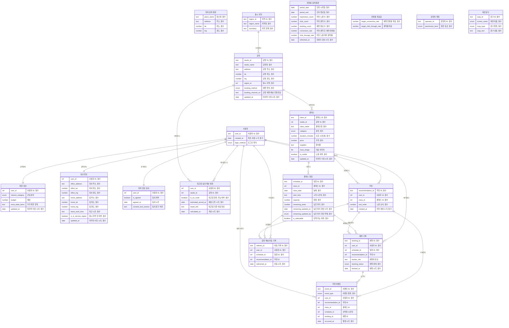

## 구성도

## 엔티티
### 사용자 (user)
서비스를 이용하는 직장인 사용자를 구분하는 묶음이다.

- **사용자 ID** (user_id, text, 필수): 예 "user_000123", 화면 -
- **최초 이용 시각** (created_at, date, 필수): 예 "2026-11-02 19:05", 화면 -
- **로그인 방식** (login_method, enum, 선택): 예 "[확인 필요: 로그인 필요 여부]", 화면 -

### 취향 정보 (taste_profile)
처음 이용할 때 받는 최소 취향과 예산이다.

- **사용자 ID** (user_id, ref, 필수): 예 "user_000123", 화면 -
- **관심 분야** (interest_category, enum, 선택): 예 "[확인 필요: 취향 입력 항목]", 화면 취향 설정 화면, 내 설정 수정 화면
- **예산** (budget, number, 선택): 예 "[확인 필요: 취향 입력 항목]", 화면 취향 설정 화면, 내 설정 수정 화면
- **추가 취향 항목** (extra_taste_items, text, 선택): 예 "[확인 필요: 취향 입력 항목]", 화면 취향 설정 화면, 내 설정 수정 화면
- **마지막 수정 시각** (updated_at, date, 필수): 예 "2026-11-02 19:06", 화면 -

### 동선 정보 (commute_profile)
사용자가 입력한 회사 위치, 집 위치, 퇴근 시간이다.

- **사용자 ID** (user_id, ref, 필수): 예 "user_000123", 화면 -
- **회사 주소** (office_address, text, 필수): 예 "[확인 필요: 첫 출시 지역]", 화면 동선 입력 화면, 추천 목록 화면, 내 설정 수정 화면
- **회사 위도** (office_lat, number, 필수): 예 "[확인 필요: 첫 출시 지역]", 화면 -
- **회사 경도** (office_lng, number, 필수): 예 "[확인 필요: 첫 출시 지역]", 화면 -
- **집 주소** (home_address, text, 필수): 예 "[확인 필요: 첫 출시 지역]", 화면 동선 입력 화면, 추천 목록 화면, 내 설정 수정 화면
- **집 위도** (home_lat, number, 필수): 예 "[확인 필요: 첫 출시 지역]", 화면 -
- **집 경도** (home_lng, number, 필수): 예 "[확인 필요: 첫 출시 지역]", 화면 -
- **퇴근 시간** (leave_work_time, text, 필수): 예 "[확인 필요: 퇴근 시간 입력 단위]", 화면 동선 입력 화면, 추천 목록 화면, 내 설정 수정 화면
- **출시 지역 안 여부** (is_in_service_region, boolean, 필수): 예 "true", 화면 동선 입력 화면, 내 설정 수정 화면
- **마지막 수정 시각** (updated_at, date, 필수): 예 "2026-11-02 19:08", 화면 -

### 위치 검색 결과 (place_search_result)
회사나 집 위치를 찾을 때 보이는 검색 결과 한 건이다.

- **장소명** (place_name, text, 필수): 예 "[확인 필요: 지도와 경로 기술 선택]", 화면 동선 입력 화면, 내 설정 수정 화면
- **주소** (address, text, 필수): 예 "[확인 필요: 첫 출시 지역]", 화면 동선 입력 화면, 내 설정 수정 화면
- **위도** (lat, number, 필수): 예 "[확인 필요: 첫 출시 지역]", 화면 -
- **경도** (lng, number, 필수): 예 "[확인 필요: 첫 출시 지역]", 화면 -

### 위치 정보 동의 (location_consent)
위치 정보 수집과 이용에 대한 사용자의 동의 상태다.

- **사용자 ID** (user_id, ref, 필수): 예 "user_000123", 화면 -
- **동의 여부** (is_agreed, boolean, 선택): 예 "true", 화면 동선 입력 화면
- **동의 시각** (agreed_at, date, 선택): 예 "2026-11-02 19:07", 화면 -
- **동의 문구 버전** (consent_text_version, text, 선택): 예 "[확인 필요: 개인정보 동의 정책]", 화면 동선 입력 화면

### 출시 지역 (service_region)
서비스 대상 지역의 범위 정보다.

- **지역 ID** (region_id, text, 필수): 예 "region_01", 화면 -
- **지역명** (region_name, text, 필수): 예 "[확인 필요: 첫 출시 지역]", 화면 동선 입력 화면, 운영 클래스 관리 화면
- **지역 경계** (boundary, text, 필수): 예 "[확인 필요: 첫 출시 지역]", 화면 -

### 퇴근길 동선 계산 결과 (route_result)
사용자 동선 기준으로 공방별 경유 가능 여부와 도착 시각을 담는다.

- **사용자 ID** (user_id, ref, 필수): 예 "user_000123", 화면 -
- **공방 ID** (studio_id, ref, 필수): 예 "studio_0042", 화면 -
- **퇴근길 경유 가능 여부** (is_on_route, boolean, 필수): 예 "true", 화면 추천 목록 화면, 클래스 상세 화면
- **예상 도착 시각** (estimated_arrival_at, date, 필수): 예 "[확인 필요: 동선 정보 표시 방식]", 화면 클래스 상세 화면
- **퇴근길 기준 이동 정보** (travel_info, text, 선택): 예 "[확인 필요: 동선 정보 표시 방식]", 화면 클래스 상세 화면
- **계산 시각** (calculated_at, date, 필수): 예 "2026-11-02 19:08", 화면 -

### 공방 (studio)
클래스를 여는 공방과 예약 채널 연결 정보다.

- **공방 ID** (studio_id, text, 필수): 예 "studio_0042", 화면 운영 클래스 관리 화면
- **공방명** (studio_name, text, 필수): 예 "[확인 필요: 첫 출시 지역과 데이터 확보 방식]", 화면 운영 클래스 관리 화면, 클래스 상세 화면
- **공방 주소** (address, text, 필수): 예 "[확인 필요: 첫 출시 지역]", 화면 운영 클래스 관리 화면, 추천 목록 화면, 클래스 상세 화면, 예약 완료 화면
- **공방 위도** (lat, number, 필수): 예 "[확인 필요: 첫 출시 지역]", 화면 클래스 상세 화면
- **공방 경도** (lng, number, 필수): 예 "[확인 필요: 첫 출시 지역]", 화면 클래스 상세 화면
- **출시 지역** (region_id, ref, 필수): 예 "region_01", 화면 운영 클래스 관리 화면
- **예약 방식** (booking_method, enum, 필수): 예 "서비스 안 예약", 화면 운영 클래스 관리 화면, 예약 진행 화면
- **공방 예약 채널 연결 정보** (booking_channel_url, text, 선택): 예 "[확인 필요: 예약과 결제 처리 방식]", 화면 운영 클래스 관리 화면, 예약 진행 화면
- **마지막 수정 시각** (updated_at, date, 필수): 예 "2026-10-30 14:20", 화면 운영 클래스 관리 화면

### 클래스 (craft_class)
공방이 여는 원데이 클래스의 기본 정보다.

- **클래스 ID** (class_id, text, 필수): 예 "class_0108", 화면 -
- **공방 ID** (studio_id, ref, 필수): 예 "studio_0042", 화면 운영 클래스 관리 화면
- **클래스명** (class_name, text, 필수): 예 "[확인 필요: 첫 출시 지역과 데이터 확보 방식]", 화면 운영 클래스 관리 화면, 추천 목록 화면, 클래스 상세 화면, 예약 진행 화면, 예약 완료 화면
- **분야** (category, enum, 필수): 예 "[확인 필요: 취향 입력 항목]", 화면 운영 클래스 관리 화면
- **소요 시간(분)** (duration_minutes, number, 필수): 예 "[확인 필요: 첫 출시 지역과 데이터 확보 방식]", 화면 운영 클래스 관리 화면, 추천 목록 화면, 클래스 상세 화면
- **가격** (price, number, 필수): 예 "[확인 필요: 첫 출시 지역과 데이터 확보 방식]", 화면 운영 클래스 관리 화면, 추천 목록 화면, 클래스 상세 화면, 예약 진행 화면
- **준비물** (supplies, text, 선택): 예 "[확인 필요: 빈 항목 표시 정책]", 화면 운영 클래스 관리 화면, 클래스 상세 화면, 예약 완료 화면
- **대표 이미지** (main_image, file, 선택): 예 "[확인 필요: 클래스 이미지 확보]", 화면 클래스 상세 화면
- **노출 여부** (is_visible, boolean, 필수): 예 "true", 화면 운영 클래스 관리 화면
- **마지막 수정 시각** (updated_at, date, 필수): 예 "2026-10-30 14:25", 화면 운영 클래스 관리 화면

### 클래스 일정 (class_schedule)
클래스의 날짜별 시간대와 정원, 남은 자리다.

- **일정 ID** (schedule_id, text, 필수): 예 "sch_20261112_01", 화면 -
- **클래스 ID** (class_id, ref, 필수): 예 "class_0108", 화면 운영 클래스 관리 화면
- **날짜** (class_date, date, 필수): 예 "2026-11-12", 화면 운영 클래스 관리 화면, 추천 목록 화면, 클래스 상세 화면, 예약 진행 화면, 예약 완료 화면
- **시작 시간대** (start_time, text, 필수): 예 "[확인 필요: 우회 허용 기준]", 화면 운영 클래스 관리 화면, 추천 목록 화면, 클래스 상세 화면, 예약 진행 화면, 예약 완료 화면
- **정원** (capacity, number, 필수): 예 "[확인 필요: 첫 출시 지역과 데이터 확보 방식]", 화면 운영 클래스 관리 화면
- **남은 자리** (remaining_seats, number, 필수): 예 "[확인 필요: 남은 자리 동기화 방식]", 화면 운영 클래스 관리 화면, 추천 목록 화면, 클래스 상세 화면
- **남은 자리 갱신 시각** (remaining_updated_at, date, 필수): 예 "2026-11-12 17:40", 화면 운영 클래스 관리 화면
- **남은 자리 갱신 주체** (remaining_updated_by, enum, 필수): 예 "운영자", 화면 운영 클래스 관리 화면
- **선택 가능 여부** (is_selectable, boolean, 필수): 예 "false", 화면 추천 목록 화면, 클래스 상세 화면, 예약 진행 화면

### 추천 (recommendation)
한 번의 추천 노출 단위로 사용자에게 보여 준 클래스 추천이다.

- **추천 ID** (recommendation_id, text, 필수): 예 "rec_8f3a21", 화면 -
- **사용자 ID** (user_id, ref, 필수): 예 "user_000123", 화면 -
- **클래스 ID** (class_id, ref, 필수): 예 "class_0108", 화면 추천 목록 화면
- **노출 순서** (sort_order, number, 필수): 예 "[확인 필요: 추천 정렬 기준]", 화면 추천 목록 화면
- **추천 생성 시각** (created_at, date, 필수): 예 "2026-11-12 18:31", 화면 -

### 예약 기록 (booking)
서비스 안 예약 방식으로 받은 예약 요청과 상태다.

- **예약 ID** (booking_id, text, 필수): 예 "bk_20261112_0007", 화면 예약 완료 화면
- **사용자 ID** (user_id, ref, 필수): 예 "user_000123", 화면 -
- **일정 ID** (schedule_id, ref, 필수): 예 "sch_20261112_01", 화면 예약 진행 화면, 예약 완료 화면
- **추천 ID** (recommendation_id, ref, 선택): 예 "rec_8f3a21", 화면 -
- **예약자 정보** (booker_info, text, 선택): 예 "[확인 필요: 예약과 결제 처리 방식]", 화면 예약 진행 화면
- **예약 상태** (booking_status, enum, 필수): 예 "완료", 화면 예약 완료 화면
- **예약 시각** (booked_at, date, 필수): 예 "2026-11-12 18:35", 화면 -

### 공방 채널 이동 기록 (channel_redirect)
사용자가 공방 기존 예약 채널로 넘어간 기록이다.

- **이동 기록 ID** (redirect_id, text, 필수): 예 "rd_000551", 화면 -
- **사용자 ID** (user_id, ref, 필수): 예 "user_000123", 화면 -
- **일정 ID** (schedule_id, ref, 필수): 예 "sch_20261112_01", 화면 예약 진행 화면
- **추천 ID** (recommendation_id, ref, 선택): 예 "rec_8f3a21", 화면 -
- **이동 시각** (redirected_at, date, 필수): 예 "2026-11-12 18:36", 화면 -

### 추천 이벤트 (recommendation_event)
추천 노출, 추천 클릭, 예약 완료를 추천 ID로 잇는 이벤트 기록이다.

- **이벤트 ID** (event_id, text, 필수): 예 "ev_0f91c2", 화면 -
- **이벤트 종류** (event_type, enum, 필수): 예 "추천 클릭", 화면 추천 목록 화면, 예약 완료 화면
- **사용자 ID** (user_id, ref, 필수): 예 "user_000123", 화면 -
- **추천 ID** (recommendation_id, ref, 선택): 예 "rec_8f3a21", 화면 -
- **클래스 ID** (class_id, ref, 선택): 예 "class_0108", 화면 -
- **선택한 시간대** (schedule_id, ref, 선택): 예 "sch_20261112_01", 화면 -
- **예약 ID** (booking_id, ref, 선택): 예 "bk_20261112_0007", 화면 -
- **발생 시각** (occurred_at, date, 필수): 예 "2026-11-12 18:32", 화면 -

### 전환율 집계 결과 (conversion_summary)
기간별 추천 노출, 클릭, 예약 완료와 전환율 집계다.

- **조회 시작일** (period_start, date, 필수): 예 "2026-11-01", 화면 예약 전환율 대시보드
- **조회 종료일** (period_end, date, 필수): 예 "2026-11-30", 화면 예약 전환율 대시보드
- **추천 노출 수** (impression_count, number, 필수): 예 "[확인 필요: 노출 집계 기준]", 화면 예약 전환율 대시보드
- **추천 클릭 수** (click_count, number, 필수): 예 "[확인 필요: 전환율 정의]", 화면 예약 전환율 대시보드
- **예약 완료 수** (booking_count, number, 필수): 예 "[확인 필요: 예약 완료 측정 방식]", 화면 예약 전환율 대시보드
- **추천 클릭 후 예약 전환율** (conversion_rate, number, 선택): 예 "[확인 필요: 전환율 정의]", 화면 예약 전환율 대시보드
- **추천 노출 대비 클릭률** (click_through_rate, number, 선택): 예 "[확인 필요: 노출 집계 기준]", 화면 예약 전환율 대시보드
- **데이터 갱신 시각** (refreshed_at, date, 필수): 예 "[확인 필요: 집계 주기]", 화면 예약 전환율 대시보드

### 전환율 목표값 (conversion_target)
대시보드에서 비교 기준으로 보여 줄 목표값이다.

- **예약 전환율 목표** (target_conversion_rate, number, 필수): 예 "[확인 필요: 예약 전환율 목표]", 화면 예약 전환율 대시보드
- **클릭률 목표** (target_click_through_rate, number, 선택): 예 "[확인 필요: 클릭률 목표]", 화면 예약 전환율 대시보드

### 운영자 계정 (operator_account)
클래스 관리와 대시보드에 접근하는 운영팀 계정이다.

- **운영자 ID** (operator_id, text, 필수): 예 "op_01", 화면 -
- **권한 등급** (permission_level, enum, 필수): 예 "[확인 필요: 대시보드 접근 권한]", 화면 운영 클래스 관리 화면, 예약 전환율 대시보드

### 화면 문구 (ui_copy)
화면 제목, 안내, 빈 상태, 오류, 버튼에 쓰는 고정 문구다.

- **문구 ID** (copy_id, text, 필수): 예 "copy_reco_empty", 화면 -
- **화면 이름** (screen_name, enum, 필수): 예 "추천 목록 화면", 화면 취향 설정 화면, 동선 입력 화면, 추천 목록 화면, 클래스 상세 화면, 예약 진행 화면, 예약 완료 화면, 운영 클래스 관리 화면, 예약 전환율 대시보드, 내 설정 수정 화면
- **문구 종류** (copy_type, enum, 필수): 예 "빈 상태", 화면 취향 설정 화면, 동선 입력 화면, 추천 목록 화면, 클래스 상세 화면, 예약 진행 화면, 예약 완료 화면, 운영 클래스 관리 화면, 예약 전환율 대시보드, 내 설정 수정 화면
- **문구 내용** (copy_text, text, 필수): 예 "[확인 필요: 빈 결과 처리 방식]", 화면 취향 설정 화면, 동선 입력 화면, 추천 목록 화면, 클래스 상세 화면, 예약 진행 화면, 예약 완료 화면, 운영 클래스 관리 화면, 예약 전환율 대시보드, 내 설정 수정 화면

## 관계
- 사용자 1:1 취향 정보 — 입력한다
- 사용자 1:1 동선 정보 — 입력한다
- 사용자 1:1 위치 정보 동의 — 동의한다
- 사용자 1:N 퇴근길 동선 계산 결과 — 계산받는다
- 공방 1:N 퇴근길 동선 계산 결과 — 판단된다
- 출시 지역 1:N 공방 — 포함한다
- 공방 1:N 클래스 — 운영한다
- 클래스 1:N 클래스 일정 — 가진다
- 사용자 1:N 추천 — 받는다
- 클래스 1:N 추천 — 추천된다
- 사용자 1:N 예약 기록 — 예약한다
- 클래스 일정 1:N 예약 기록 — 예약받는다
- 추천 1:N 예약 기록 — 이어진다
- 사용자 1:N 공방 채널 이동 기록 — 이동한다
- 클래스 일정 1:N 공방 채널 이동 기록 — 연결된다
- 추천 1:N 공방 채널 이동 기록 — 이어진다
- 추천 1:N 추천 이벤트 — 기록한다
- 예약 기록 1:N 추천 이벤트 — 남긴다
- 사용자 1:N 추천 이벤트 — 발생시킨다

## 확인 필요
- 로그인이나 회원 가입이 필요한가? 필요 없다면 사용자 ID를 기기 단위로 만들지 정해야 한다.
- 취향 정보는 어떤 항목으로 받는가? 관심 분야와 예산 중 무엇을 필수로 하는가? 지금은 모두 필수 아님으로 두었다.
- 관심 분야 선택지와 클래스 분야 값을 같은 목록으로 맞추는가?
- 퇴근 시간은 하나만 받는가, 요일별로 받는가?
- 회사와 집 위치를 주소와 좌표로 얼마나 보관하는가? 탈퇴나 이용 중단 시 언제 지우는가?
- 위치 정보 이용 동의가 필요한가? 필요하다면 동의 문구 버전과 동의 시각을 어떻게 보관하는가?
- 입력한 위치가 첫 출시 지역 밖일 때 저장을 막는가, 대기 안내와 함께 저장하는가?
- 첫 출시 지역은 어디이고, 지역 경계는 어떤 형태로 저장하는가?
- 퇴근길 동선 계산 결과를 저장하는가, 요청할 때마다 계산하는가? 저장한다면 언제 다시 계산하는가?
- 예약 방식은 공방 단위로 정하는가, 클래스나 일정 단위로 정하는가?
- 서비스 안 예약 시 예약자 정보로 어떤 항목을 받는가? 이름과 연락처라면 보관 기간과 공방 제공 범위는 무엇인가?
- 예약 상태 값은 무엇으로 두는가? 취소와 변경을 MVP에서 다루는가?
- 같은 사용자가 같은 일정을 중복 예약하는 것을 막는가?
- 공방 채널로 넘어간 뒤 예약 완료를 어떻게 확인해 예약 완료 이벤트로 남기는가?
- 추천 ID는 카드 한 장 단위인가, 추천 목록 한 번 단위인가?
- 추천 노출은 목록 응답 시점에 세는가, 카드가 화면에 보인 시점에 세는가?
- 추천 ID가 없는 예약 완료를 추천 경유 예약에서 빼는가?
- 예약 전환율의 분모와 분자를 사용자 단위로 보는가, 클릭 단위로 보는가? 클릭 후 예약 인정 기간은 얼마인가?
- 추천 이벤트와 공방 채널 이동 기록의 보관 기간은 얼마인가?
- 예약 전환율 목표와 클릭률 목표는 얼마인가?
- 대시보드 접근 권한 등급은 어떻게 나누는가? 집계 주기는 얼마인가?
- 남은 자리는 누가 얼마나 자주 공방과 맞추는가? 실제 잔여석과 다를 때 사용자에게 어떻게 안내하는가?
- 공방, 클래스, 일정 수정 시 수정한 운영자를 기록하는가?
- 준비물과 대표 이미지가 비어 있는 클래스를 노출해도 되는가? 비어 있을 때 표시 방식은 무엇인가?
- 공방 예약 채널 연결 정보는 어떤 형태로 받는가? 정보가 없을 때 어떻게 처리하는가?
- 내 설정 수정 화면(R9)을 MVP에 넣는가?
- 빈 결과 안내 문구와 대안 제시 방식은 무엇인가?
